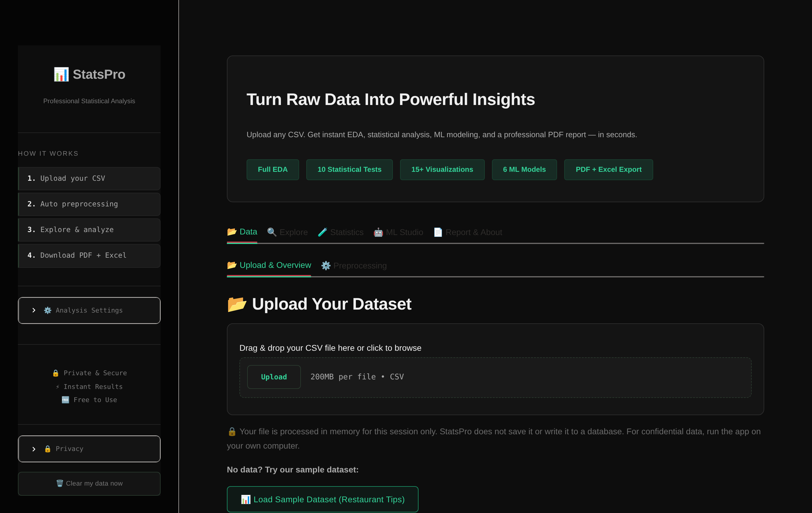
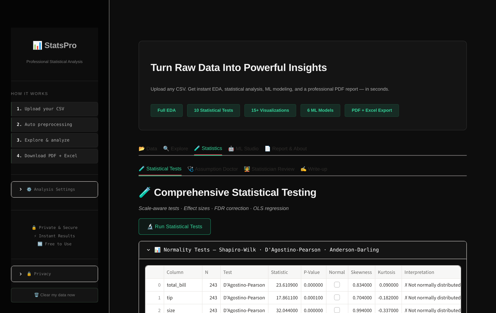
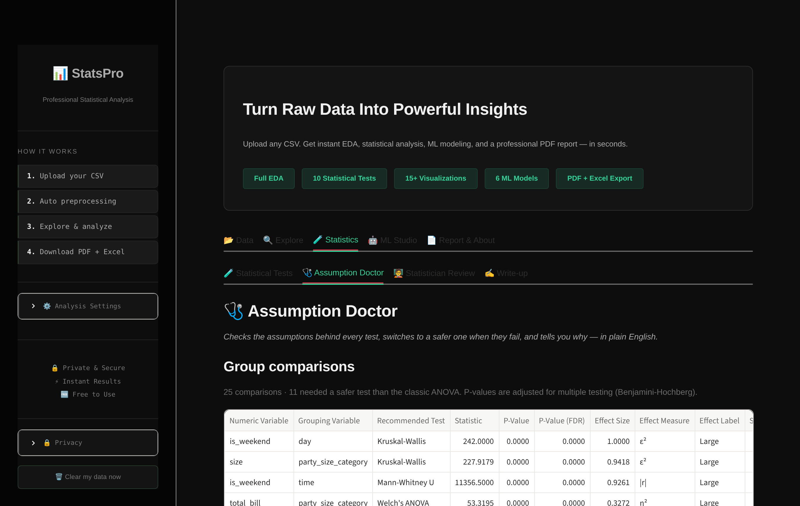
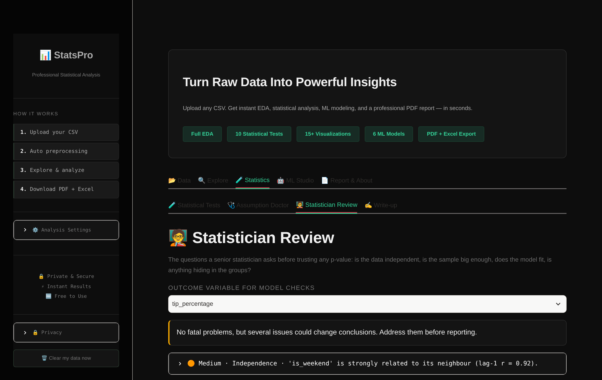
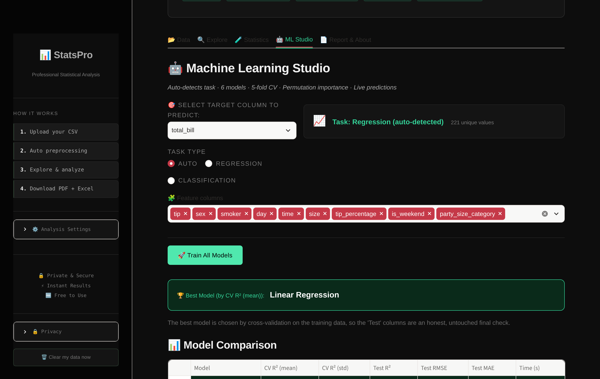
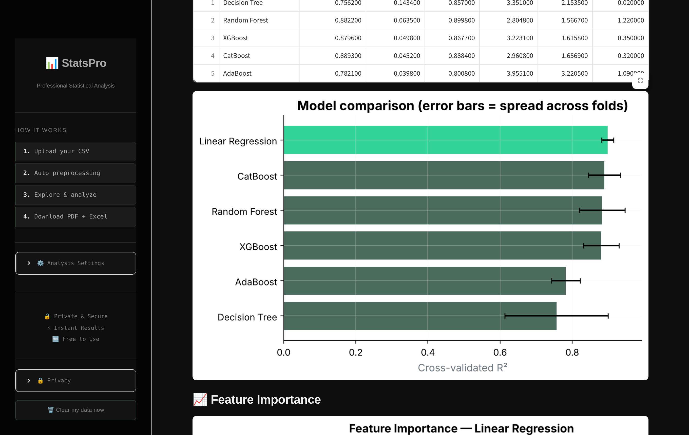

<div align="center">

# StatsPro

**Statistical analysis for students and researchers — no coding needed**

[](https://github.com/Junaid-Ahmed-Rupok/statistical-analysis-app)
[](https://python.org)
[](https://streamlit.io)
[](LICENSE)

Working on a thesis or assignment? Upload your CSV and get the right tests, plain-English explanations, charts and an APA-style write-up.

[**Analyze your dataset, free →**](https://statistical-analysis-app-7axetqtx75ncuu7fr8irxj.streamlit.app)

</div>

---

## 🎓 Problems StatsPro solves

| You are thinking… | StatsPro gives you |
|---|---|
| "I don't understand my dataset." | Instant summary, data-quality score and charts |
| "My data has missing values." | Automatic cleaning, with every choice logged |
| "Which statistical test should I use?" | **Assumption Doctor**: picks the test and says why |
| "What does this p-value mean?" | Plain-English results with effect sizes and multiple-testing correction |
| "I need charts for my thesis." | 15+ publication-style visualizations |
| "I need the Results section." | **APA-style write-up** and a PDF report |
| "Can I trust this model?" | **Trust Report**: honest error ranges and fairness by group |
| "Can I reproduce this later?" | A script that recomputes every number, plus an **Integrity Seal** |

### 🔒 Your data

StatsPro does not save your files. An uploaded CSV is processed in memory for your session only and is gone when the session ends; nothing is written to a database. A **Clear my data now** button removes everything instantly, and the app warns you when a column looks like personal information (names, emails, phone numbers). The hosted demo runs on Streamlit Community Cloud, so for confidential data run it on your own machine (see Quickstart). Automated suggestions are a starting point, not a substitute for your supervisor's or statistician's judgment.

---

## 📸 Screenshots

<table>
  <tr>
    <td width="50%"><br/><sub><b>Upload &amp; Overview</b> — data quality score at a glance</sub></td>
    <td width="50%"><br/><sub><b>Statistical Tests</b> — scale-aware tests with effect sizes and FDR correction</sub></td>
  </tr>
  <tr>
    <td width="50%"><br/><sub><b>Assumption Doctor</b> — checks assumptions, switches to a safer test, explains why</sub></td>
    <td width="50%"><br/><sub><b>Statistician Review</b> — independence, sample size, confounding and model checks</sub></td>
  </tr>
  <tr>
    <td width="50%"><br/><sub><b>ML Studio</b> — six models compared with cross-validation</sub></td>
    <td width="50%"><br/><sub><b>Model charts</b> — ROC, precision-recall, calibration, residuals, learning curve</sub></td>
  </tr>
</table>

---

## What is StatsPro?

StatsPro is a production-ready Streamlit web app that takes any CSV file and delivers comprehensive exploratory data analysis, statistical hypothesis testing, automated machine learning, and professional PDF reports — all through a polished, code-free interface.

It's built for analysts, researchers, and data scientists who need rigorous results fast, with a premium dark theme (pure black + emerald green) and monospace typography designed for extended analytical sessions.

---

## Features at a Glance

### AI Assistant (new)
- **Ask the assistant** button in the sidebar: plain-language answers about any statistics term (t-test, p-value, ANOVA, VIF and more) and about your own results
- **Screenshot questions:** attach an image of the part you don't understand and the assistant explains it
- Only column names and test results are sent to the AI, never your data rows
- Free: 5 questions a day. Pro 7-day: 15 a day. Pro 30-day: unlimited
- Needs a free `GROQ_API_KEY` in the app secrets; without it the button is simply hidden

### Data Upload & Quality Scoring
- Drag-and-drop CSV upload up to 200 MB
- Built-in sample dataset for instant testing
- Automatic data quality score (0–100) with missing value heatmap
- Column type detection and memory usage summary

### Intelligent Preprocessing
- KNN imputation (k=5) for numeric columns; mode imputation for categorical
- IQR-based outlier detection with Winsorization
- Exact duplicate and constant-column removal
- Full preprocessing activity log
- Download cleaned dataset as CSV

### Exploratory Data Analysis
- Per-column summary: type, unique count, missing %, descriptive stats
- Histograms, bar charts (top 10), ranked correlation table
- Skewness, kurtosis, and missing value heatmap

### Statistical Testing

Ten tests, all with **Benjamini-Hochberg FDR correction** to control false positives:

| Test | Use Case | Effect Size |
|---|---|---|
| Shapiro-Wilk / D'Agostino-Pearson / Anderson-Darling | Normality | Skewness & Kurtosis |
| Pearson & Spearman Correlation | Linear & monotonic relationships | 95% Confidence Intervals |
| Chi-Square | Categorical independence | Cramér's V |
| One-Way ANOVA | Group mean comparisons | Eta-Squared (η²) |
| Mann-Whitney U | Non-parametric group test | Rank-Biserial r |
| Levene's Test | Variance equality | — |
| VIF Analysis | Multicollinearity detection | Condition Number (κ) |
| OLS Regression | Auto-target linear modeling | R², AIC, BIC |

### Statistician Review
A senior-statistician-style second opinion before you trust a p-value:
- Independence and repeated-measures warnings, multiple-testing exposure
- Power analysis and sample-size planning, minimum detectable effect
- Simpson's-paradox and confounding checks, missing-data pattern checks
- Regression diagnostics: curvature, influential rows, heteroscedasticity

### Visualizations (15+ chart types)
- Histograms with KDE overlay
- Box plots with outlier markers
- Pearson & Spearman correlation heatmaps
- Pairwise scatter plots
- Q-Q plots for normality assessment
- VIF bar charts with risk color-coding

### AI-Powered Insights
- Executive data quality tier assessment
- Missing data mechanism classification (MCAR / MAR / MNAR)
- Transformation recommendations based on skewness and kurtosis
- Multicollinearity remediation paths
- Prioritized action items (P1 / P2 / P3)
- Production readiness score (0–100)

### Machine Learning Studio
- Auto-detects regression vs. classification tasks
- Trains 6 models simultaneously: Linear/Logistic Regression, Decision Tree, Random Forest, XGBoost, CatBoost, AdaBoost
- 5-fold cross-validation with held-out test metrics
- Model comparison table with the best model highlighted
- Permutation feature importance
- Diagnostic charts: ROC, precision-recall, calibration, confusion matrix, residuals and learning curve (with advice on whether more data would help)
- **Trust Report** (Pro): prediction intervals with measured coverage, fairness by group
- Live and batch prediction, and model download (Pro)
- Handles mixed-type columns automatically

### Export Options
- **PDF Report** — professional cover page, KPI cards, embedded charts, AI insights, page numbers, and confidentiality watermarks
- **Excel Report** — all data and test results in separate sheets
- **Cleaned CSV** — preprocessed data ready for downstream use (Pro)

---

## Quickstart

### Prerequisites
- Python **3.11 or newer** (check with `python --version`) — or just Docker

### Run it (pick one)

**Any machine with Docker** (no Python needed):

```bash
git clone https://github.com/Junaid-Ahmed-Rupok/statistical-analysis-app.git
cd statistical-analysis-app
docker build -t statspro .
docker run -p 8501:8501 statspro
```

**macOS / Linux:** `./run.sh`  **Windows:** double-click `run.bat`

Both create a private `.venv`, install dependencies and start the app.

**Manual:**

```bash
git clone https://github.com/Junaid-Ahmed-Rupok/statistical-analysis-app.git
cd statistical-analysis-app
python -m venv .venv
# macOS/Linux: source .venv/bin/activate    Windows: .venv\\Scripts\\activate
pip install -r requirements.txt
streamlit run app.py
```

Open [http://localhost:8501](http://localhost:8501) in your browser.

---

## Usage

The app has 5 main sections with sub-tabs, meant to be used roughly in order:

| Section | What is inside |
|---|---|
| 📂 Data | Upload (or use the built-in sample) and Preprocessing |
| 🔍 Explore | EDA, Visualizations, AI Insights |
| 🧪 Statistics | Statistical Tests, Assumption Doctor, Statistician Review, Write-up |
| 🤖 ML Studio | Train 6 models, diagnostic charts, Trust Report, predictions |
| 📄 Report & About | PDF Report, About the developer |

---|---|
| 1. Upload | Load a CSV or use the built-in sample dataset |
| 2. Preprocess | Clean data and handle outliers |
| 3. EDA | Explore distributions and correlations |
| 4. Statistics | Run all 10 statistical tests |
| 5. Visualizations | Generate charts, heatmaps, and Q-Q plots |
| 6. Insights | Read the AI-generated narrative report |
| 7. PDF Report | Download the PDF report |
| 8. ML Studio | Train 6 models; ROC, precision-recall, calibration, confusion matrix, residuals and learning curve; Pro adds the Trust Report and predictions |
| 9. Assumption Doctor | See which test fits your data and why |
| 10. Write-up | APA-style Methods/Results text and a reproduce script |
| 11. Statistician Review | Design, independence, confounding and model checks; power and sample-size planning |
| 12. About | About the developer and how to get in touch |

---

## Project Structure

```
statistical-analysis-app/
├── app.py                  # Main application (5 sections, 12 sub-tabs)
├── modules/assistant.py    # AI assistant: glossary, quotas, Groq client (text + screenshots)
├── requirements.txt        # Runtime dependencies
├── requirements-dev.txt    # Test dependencies
├── Dockerfile, run.sh, run.bat   # Run anywhere
├── MONETIZATION.md         # Optional Pro licence setup
├── AUTOPAY.md              # Optional automatic payment-to-key setup
├── tools/                  # Licence key generator and helper scripts
├── index.html              # GitHub Pages landing page
├── keepalive.py            # Keeps the Streamlit app awake (GitHub Actions)
├── data/tips.csv           # Bundled sample dataset (works offline)
├── styles/
│   └── main.css            # Dark theme CSS
├── modules/
│   ├── preprocessor.py     # Data cleaning pipeline
│   ├── statistics.py       # Statistical testing engine
│   ├── advisor.py          # Assumption Doctor (picks the right test)
│   ├── review.py           # Statistician Review (design checks, power, model diagnostics)
│   ├── writeup.py          # APA write-up + reproduce.py generator
│   ├── seal.py             # Integrity Seal + Honesty Ledger
│   ├── visualizer.py       # Chart generation (15+ types)
│   ├── insights.py         # AI insights generator
│   ├── pdf_generator.py    # PDF report builder
│   ├── ml_engine.py        # AutoML pipeline + Trust Report
│   ├── ml_plots.py         # ROC, PR, calibration, residual and learning-curve charts
│   ├── csv_loader.py       # Tolerant CSV reader with clear error messages
│   ├── privacy.py          # Personal-data column detection
│   ├── licensing.py        # Signed, expiring Pro licence keys
│   └── autopay.py          # Optional automatic key delivery
└── tests/                  # pytest suite (run: pip install -r requirements-dev.txt && pytest)
```

---

## Tech Stack

| Layer | Technology |
|---|---|
| Framework | Streamlit |
| Data | Pandas, NumPy |
| Statistics | SciPy, Statsmodels |
| Machine Learning | Scikit-learn, XGBoost, CatBoost |
| Visualization | Matplotlib, Seaborn |
| PDF | ReportLab |
| Excel | OpenPyXL |

---

## Deployment

The app is deployed on Streamlit Cloud and auto-updates on every push to `main`.

To deploy your own fork:

1. Fork this repository
2. Go to [share.streamlit.io](https://share.streamlit.io)
3. Connect your GitHub account, select the repo, and deploy

---

## 👨‍💻 About the Developer

<div align="center">


### Sarder Junaid Ahmed
**Data Scientist & Machine Learning Engineer** · B.Sc. in CSE, RUET (Rajshahi University of Engineering & Technology), 2025

*Transforming complex data into strategic decisions through rigorous statistical modeling and production-ready machine learning systems.*

[](https://github.com/Junaid-Ahmed-Rupok)
[](https://www.linkedin.com/in/sarder-junaid-ahmed-059b68240/)
[](https://junaid-ahmed-rupok.github.io/__portfolio__Yes/)
[](mailto:junaidahmedrupok@gmail.com)
</div>

**Specializations:** Statistical ML · Causal Inference · Trustworthy AI · Fairness-Aware ML · RAG Systems

**Selected Research:**
- 📄 **Ahmed, S.J.** et al. (2026). *Machine Learning for Crime Classification: A Fairness-Aware Approach to Class Imbalance.* Journal of Machine Learning and Applications, 2(1), 9–17. [DOI: 10.61577/jmla.2026.100002](https://doi.org/10.61577/jmla.2026.100002)
- 📄 **Ahmed, S.J.** et al. (2026). *Machine Learning for Crime Classification: A Fairness-Aware Approach to Class Imbalance.* IEEE SPICSCON 2026, BAUET, Bangladesh (Aug 13–14, 2026). **Accepted for Presentation** — IEEE Xplore.
- 📄 **Ahmed, S.J.** et al. (2026). *CF-EGAT: A Causal Fairness-Aware Equity Graph Attention Network for Country-Level Environmental Livability Classification.* SPECTRA 2026. 🏆 **1st Best Paper Award**
- 📄 **Ahmed, S.J.** (2025). *Multi-Dimensional Statistical Similarity for Governance Classification: Beyond Arbitrary Thresholds.* APMEE 2025. 🏆 **Best Research Paper Award**
- 📄 **Ahmed, S.J.** (2026). *DeepEnMap: Ordinal-Aware Multi-Modal Deep Learning for Energy Poverty Risk Mapping.* IEMIS 2026, University of British Columbia, Vancouver, Canada (Aug 10–12, 2026). **Accepted for Presentation** — Springer LNNS Series (Scopus, EI-Compendex, DBLP, ISI Proceedings).
- 📄 **Ahmed, S.J.** (2026). *Density-Decoupled, Mask-Ablated Segmentation-Guided Diffusion for Controllable Mammography Synthesis: A Preliminary Study.* IEMIS 2026, University of British Columbia, Vancouver, Canada (Aug 10–12, 2026). **Accepted for Presentation** — Springer LNNS Series (Scopus, EI-Compendex, DBLP, ISI Proceedings).
- 📄 **Ahmed, S.J.**, Islam Nahian, M.T., & Kwoshik, M.H.R. (2026). *Environmental Livability Assessment via Adaptive Bootstrap-Retrained SHAP and Statistically-Constrained Pareto Counterfactuals: A Cross-National Analysis.* IEEE SPICSCON 2026, BAUET, Bangladesh (Aug 13–14, 2026). **Accepted for Presentation** — IEEE Xplore.
- 📄 **Ahmed, S.J.** (2026). *DemocracyGuard: Testing a Divergence-Index Reconciliation of Subjective and Objective Democracy Indicators for Forecasting Adverse Regime Transitions.* **Under Review**, Transactions on Machine Learning Research (TMLR) — Q1, Top-Tier Journal.
- 📄 **Ahmed, S.J.** (2026). *FAI: Feature-Wise Adaptive Imputation via Downstream-Aware Method Selection.* **Under Review**, ICISET 2026 (IEEE Xplore).

**Other Deployed Projects:**
- 🔬 [ReproHub](https://reproapp-8jb7vbhnqyltxq23bsr8xn.streamlit.app/) — Automated research reproducibility platform with composite scoring across 11 statistical tests
- 📊 [StatsPro](https://statistical-analysis-app-7axetqtx75ncuu7fr8irxj.streamlit.app/) — AI-powered statistical analysis platform with automated CSV-to-report workflows

**Honors:**
🏆 1st Best Paper — SPECTRA 2026 &nbsp;·&nbsp;
🏆 Best Research Paper — APMEE 2025 &nbsp;·&nbsp;
🎖️ Esteemed Alumni Award — YLRL RUET 2024 &nbsp;·&nbsp;
⭐ Perfect GPA 5.00/5.00 — SSC & HSC &nbsp;·&nbsp;
🎓 National Merit Scholarship — 2009 & 2013

---

## ✨ What makes StatsPro different

- **🩺 Assumption Doctor** — checks normality, variance and outliers for every comparison, switches to Welch's ANOVA / Mann-Whitney / Kruskal-Wallis / Spearman when the classic test would mislead, and explains each choice in plain English (with FDR correction across all tests).
- **✍️ Thesis-ready write-up** — APA-style Methods and Results paragraphs, plus a `reproduce.py` script that recomputes every reported p-value from your data (tested to match).
- **🛡️ Trust Report in ML Studio** — prediction intervals / sets with *measured* coverage (split-conformal), per-group performance and fairness gaps (even for columns left out of the model), and warnings when a result looks too good to be true.

- **🔐 Integrity Seal & Honesty Ledger (in every PDF)** — the last page fingerprints your exact data (SHA-256, checkable with `sha256sum cleaned_data.csv` or the in-app verifier) and states how many hypotheses were tested, how many would look significant by chance alone, and how many survive multiple-testing correction.

## 💎 Free vs Pro

**Free:** upload, preprocessing, EDA, all charts, the basic statistical tests (normality, correlation, chi-square), AI insights, ML Studio training with model comparison and all diagnostic charts, the first rows of the Assumption Doctor, a write-up preview and the Statistician Review verdict.

**Pro:** the advanced tests (ANOVA, Mann-Whitney, Levene, multicollinearity, OLS regression), the full Assumption Doctor, the full write-up and reproduce script, Statistician Review details and the sample-size planner, the ML Trust Report, live and batch prediction, model download, PDF report and cleaned CSV download.

**AI assistant limits:** Free 5 questions a day, Pro 7-day 15 a day, Pro 30-day unlimited.

Pro is unlocked with a signed licence key that expires after 7 or 30 days, available by bKash or card. Licence setup is off by default; see [MONETIZATION.md](MONETIZATION.md). Need hands-on help? Use **Work with me** on the About tab.

## License

MIT — see [LICENSE](LICENSE).

<div align="center">

Built by [Junaid Ahmed Rupok](https://github.com/Junaid-Ahmed-Rupok)

Built with [Streamlit](https://streamlit.io), [SciPy](https://scipy.org), [statsmodels](https://www.statsmodels.org) and [scikit-learn](https://scikit-learn.org)

</div>
